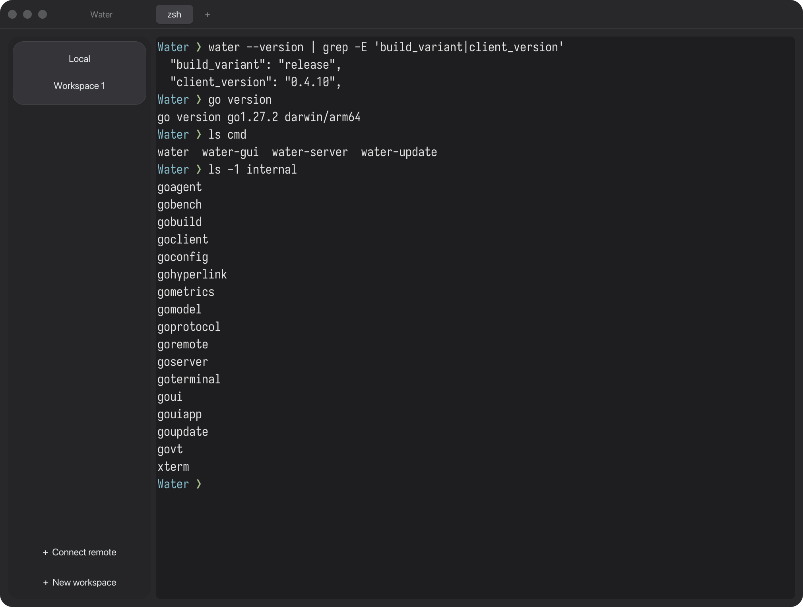
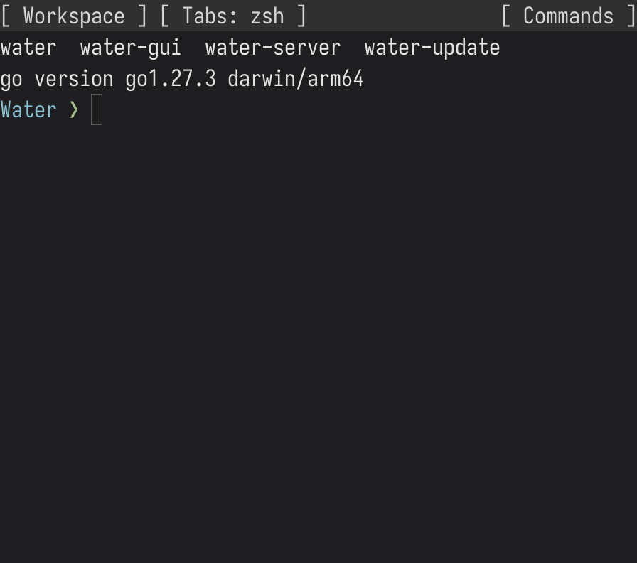
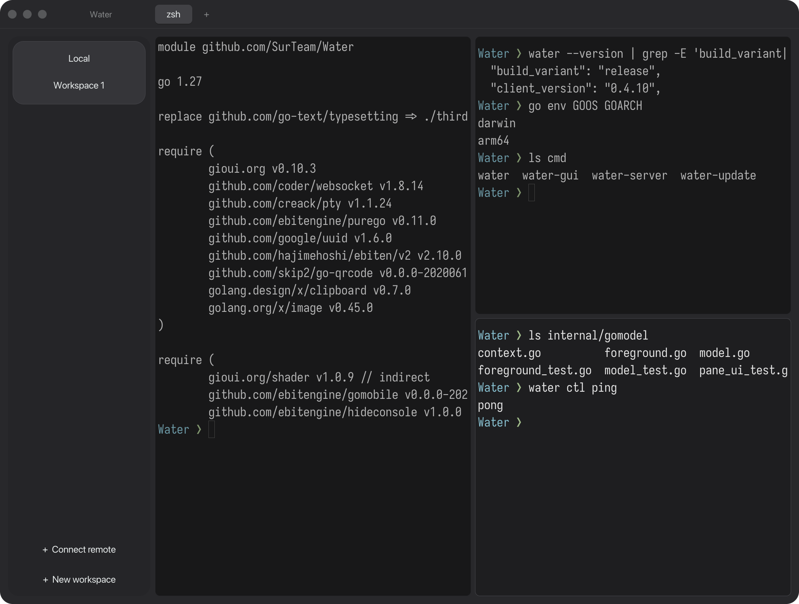

# Water

**One session backend. Three ways to keep working.**

Water is a terminal workbench for shells, remote environments, and coding agents. Work at your desk in the native **GUI**, attach over SSH with the **TUI**, or open the **Web** frontend in a browser. Connect to the same Water server to reach the same workspaces and running terminals wherever you are.



## Your terminals, wherever work takes you

| Where you are | Open Water with | What you can do |
| --- | --- | --- |
| At your desk | **GUI** | Organize local and SSH workspaces with tabs, split panes, and a full desktop terminal. |
| Inside an SSH session | **TUI** | Attach from an existing terminal, switch workspaces and panes, then detach while shells keep running. |
| On your phone or another computer | **Web** | Pair a browser with your server and continue in its terminals, with mobile keyboard helpers. |

The server owns the workspaces, terminal processes, and retained output. Each frontend has its own view and selection. Changing how you connect brings you back to the server's sessions; you do not need to start a fresh shell for each frontend.

```text
Desktop GUI ─────┐
Terminal TUI ────┼── Water server ── shells · coding agents · jobs
Browser Web ─────┘     workspaces · tabs · panes · retained output
```

## A terminal workbench that fits in your terminal

Run `water tui --ssh user@host` from a terminal on the device you have with you. A mobile SSH terminal, such as 网易 UU 的 Terminal, makes this a useful way to reach your work away from your desk: Water supplies the workspace, tab, and pane navigation inside the terminal.

Below 90 columns, the TUI switches to a compact layout. The sidebar gives way to workspace and tab selectors, and the selected pane gets the available screen space. Hidden split panes remain accessible from the pane selector.



*Actual 56-column TUI captured inside a Water desktop terminal, cropped to the terminal viewport. This image demonstrates the narrow layout; it was not captured in UU Terminal.*

```sh
# Attach to your local Water server
water tui

# Reach a Water server over SSH
water tui --ssh user@host
```

Press **Ctrl-B**, release it, then press **q** to detach and leave the shells running. Use **Ctrl-B p** to select a pane or **Ctrl-B ?** for the command menu. See [TUI controls](docs/terminal-ui.md).

## Know which agent is working where

Water detects **Claude Code, Codex, Pi Coding Agent, and OpenCode** from foreground processes and command arguments. Agent labels help you find the right session among your shells, tabs, and panes. Custom recognition rules let you add other tools and choose their names and colors.

Agent integrations can report structured status and progress through terminal metadata. Recognition works from process information; work status comes from those reports, and remains unknown when no status is reported. See [Agent integration](docs/agent-integration.md).

## Room for the whole workflow



- **A native desktop workspace:** tabs, recursive split panes, scrollback, selection and copy, hyperlinks, configurable shortcuts, and Sarasa Term SC by default.
- **Local and remote side by side:** bring SSH workspaces into the GUI connection sidebar, with remote connection and reconnect state.
- **Direct browser access:** enable the server's Web service and pair a device by link or QR code. The browser connects to that server directly and can create tabs and splits. See [Web setup and pairing](docs/browser-access.md).
- **An automation interface:** inspect sessions, query terminals, and drive real GUI actions through the versioned `water ctl` API. See [Control commands](docs/control-api.md).

Web access requires a network path to your server. Output replay is bounded by the server's retention policy; explicit server shutdown or host shutdown ends running sessions.

## Start here

The packaged product targets macOS first. The repository also supports Linux development builds.

```sh
# Start the desktop GUI from source
go run ./cmd/water
```

For browser access, open **Settings → Server → Web service**, start the listener, and pair your device. For terminal access, use `water tui` from an installed Water executable.

See the [design and development guide](docs/README.md) for architecture, configuration, control commands, testing, and packaging. The full configuration schema is in [config.example.json](config.example.json).

## Project status

Water is under active development. Its GUI, TUI, and Web frontends share a session backend, with independent terminal emulation and view state in each client. Frontend controls and rendering capabilities vary; the linked guides describe their current behavior.

## License

MIT OR Apache-2.0.
